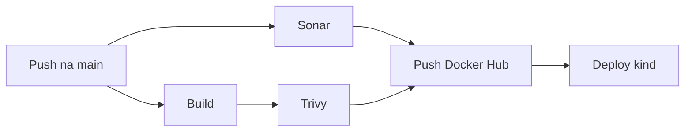

# Pipeline DevSecOps: do commit ao cluster kind


Trabalho da Aula 13 de DevOps (SATC): um frontend e uma pipeline no GitHub Actions que leva o código do commit até um cluster Kubernetes (kind), com análise de qualidade e de segurança antes do deploy.

## Fluxo da pipeline



| Job | O que faz | Bloqueia a pipeline se |
|---|---|---|
| **Build** | Constrói a imagem Docker do frontend e a guarda para os próximos jobs | O build falhar |
| **Sonar** | Roda os testes com cobertura e envia o código ao SonarCloud | Algum teste falhar ou o Quality Gate reprovar |
| **Trivy** | Escaneia Dockerfile e manifestos (IaC), secrets, dependências e a imagem. Gera relatórios SARIF | Houver vulnerabilidade HIGH/CRITICAL no IaC ou na imagem, CRITICAL nas dependências, ou qualquer secret no código |
| **Push** | Publica a imagem no Docker Hub com a tag do commit (SHA) e `latest` | Sonar ou Trivy falharem (não roda em pull request) |
| **Deploy (kind)** | Aplica os manifestos no cluster com a imagem do Docker Hub e testa se a aplicação responde | O rollout não terminar ou o site não responder (só roda na `main`) |

O Build e o Sonar rodam em paralelo. O Trivy espera o Build, porque escaneia exatamente a imagem que será publicada. O Push só acontece depois que Sonar e Trivy aprovam.

## Tecnologias

- **Frontend:** página estática (HTML e CSS) servida por nginx
- **Contêiner:** Docker, imagem base `nginxinc/nginx-unprivileged:alpine`
- **CI/CD:** GitHub Actions
- **Qualidade:** SonarCloud (Quality Gate)
- **Segurança:** Trivy (IaC, secrets, dependências e imagem)
- **Registro de imagens:** Docker Hub
- **Orquestração:** Kubernetes em kind (Kubernetes in Docker)

## Estrutura do repositório

```
.
├── .github/workflows/pipeline.yml   # pipeline com os 5 jobs
├── k8s/
│   ├── deployment.yaml              # 2 réplicas, contêiner sem root
│   └── service.yaml                 # NodePort 30080
├── src/ e test/                     # JavaScript com testes (node:test + c8) para a cobertura do Sonar
├── Dockerfile
├── nginx.conf
├── index.html e style.css           # frontend
├── kind-config.yaml                 # cluster kind (porta 8082 do host -> 30080)
├── sonar-project.properties         # configuração do SonarCloud
└── package.json
```

## Como reproduzir

### 1. Secrets do GitHub

Em *Settings → Secrets and variables → Actions*:

| Secret | Valor |
|---|---|
| `DOCKERHUB_USERNAME` | Usuário do Docker Hub |
| `DOCKERHUB_TOKEN` | Token de acesso do Docker Hub (leitura e escrita) |
| `SONAR_TOKEN` | Token gerado no SonarCloud |

No Docker Hub, o repositório `frontend-devsecops` precisa ser **público**. No SonarCloud, desligue a "Automatic Analysis" do projeto e confira a organização e a project key no `sonar-project.properties`.

### 2. Cluster kind

```bash
kind create cluster --name devsecops --config kind-config.yaml
kubectl get nodes
```

### 3. Runner self-hosted

O deploy roda num runner na máquina onde está o cluster, porque os runners do GitHub ficam na nuvem e não enxergam o kind local. Em *Settings → Actions → Runners → New self-hosted runner*, siga os comandos do GitHub e inicie o runner (`run.cmd` no Windows, `./run.sh` no Linux). O usuário que roda o runner precisa conseguir executar `kubectl get nodes`.

### 4. Disparar a pipeline

Qualquer push na `main` inicia a pipeline. Também é possível rodar manualmente em *Actions → DevSecOps Pipeline → Run workflow*. Ao final, a aplicação fica em **http://localhost:8082**.

## Rodar localmente

```bash
docker build -t frontend-devsecops:local .
docker run --rm -p 8081:8080 frontend-devsecops:local
```

Abra http://localhost:8081.

## Decisões técnicas

- **SonarCloud em vez de SonarQube local:** o runner da nuvem não alcança um servidor local.
- **Runner self-hosted só no deploy:** pelo mesmo motivo, o cluster kind roda na máquina do grupo.
- **Tag da imagem = SHA do commit:** cada versão fica rastreável até o commit que a gerou.
- **A mesma imagem do Build segue até o Push:** ela é salva como artefato, escaneada pelo Trivy e só então publicada.
- **Relatório e gate separados no Trivy:** o relatório gera o resultado completo em SARIF (artifacts e aba Security), e o gate é quem bloqueia a pipeline.

## Segurança aplicada

- Contêiner sem root (`nginx-unprivileged`, `USER 101`)
- Pacotes do Alpine atualizados na construção da imagem (`apk upgrade`), o que corrigiu as vulnerabilidades que o Trivy barrou no primeiro build
- No Kubernetes: `readOnlyRootFilesystem`, capabilities removidas, sem escalonamento de privilégio, perfil seccomp e limites de CPU e memória
- Secrets só em GitHub Secrets, nunca no código

## Evidências

- **Pipeline funcionando:** aba [Actions](../../actions)
- **Relatório do Sonar:** projeto no SonarCloud, com o Quality Gate aprovado
- **Relatório do Trivy:** aba [Security → Code scanning](../../security/code-scanning) e os logs dos gates no Actions
- **Imagem publicada:** [Docker Hub](https://hub.docker.com/r/joojoojooj/frontend-devsecops)
- **Frontend no ar:** http://localhost:8082, com `kubectl get pods,svc` mostrando os pods em `Running`
